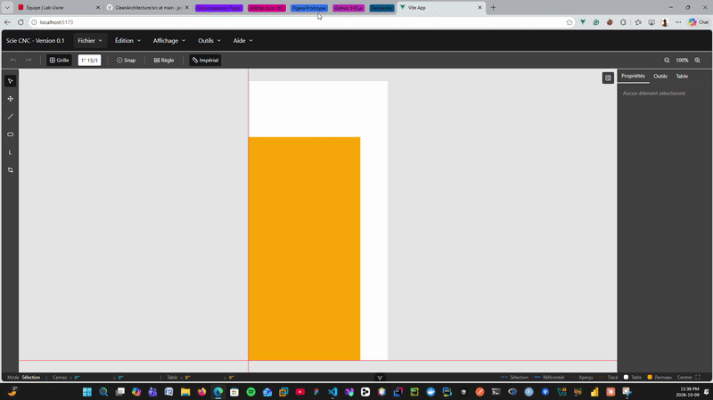
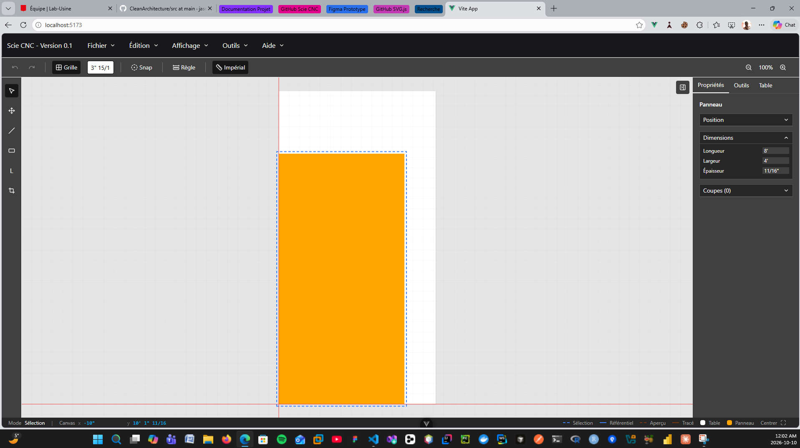
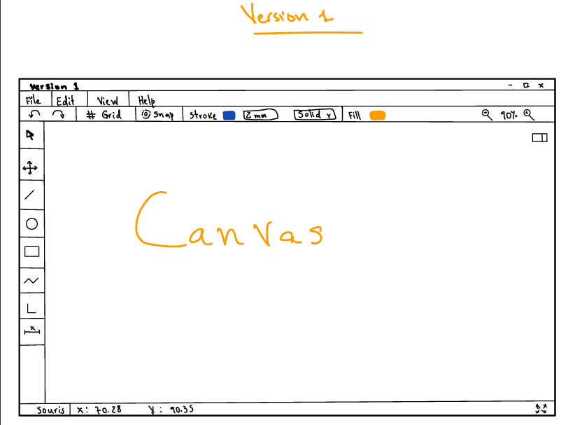
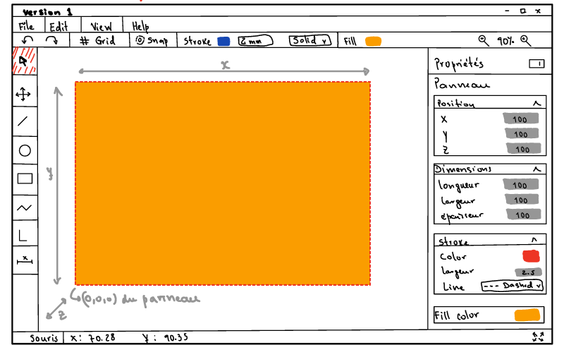
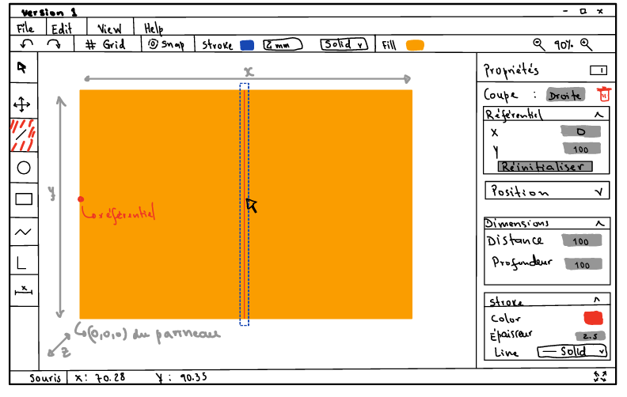
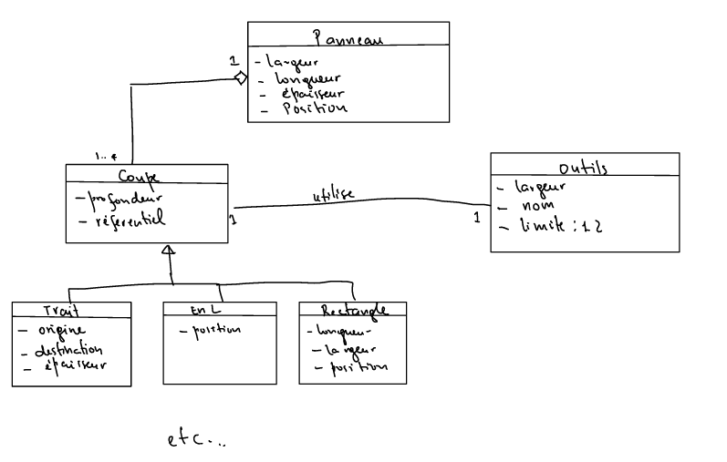

# Scie CNC

Application web pour planifier le débit de panneaux sur une scie à commande numérique (CNC) : on dessine le plan de coupe d'un panneau (traits, coupes rectangulaires, coupes en L, retaillage), avec cotation et gestion des outils, en vue de générer le G-code exécuté par la machine.
> Ce repo n'est qu'une documentation du projet. Le projet et le code demeurent la propriété du Lab-usine.

## Contexte

- **Client :** Laboratoire Usine (LabUsine), Université Laval.
- **Période :** septembre 2026 à décembre 2026.
- **Mandat :** remplacer un processus de traçage manuel par un outil numérique permettant de dessiner un plan de coupe, de valider qu'il tient dans le panneau et la table de la machine, puis d'en exporter le G-code.
- **Réalisation :** réalisé par `Petiton Wiseley` sous la supervision des professionnels de recherche du Lab Usine `Anthony Deschênes`, `Eloïse Prévôt`, et `Corantin Labelle`.

## Démo





## Fonctionnalités principales

- Dessin de coupes sur un panneau : trait droit, rectangle, coupe en L, retaillage (réduction des dimensions du panneau).
- Référentiels : chaque coupe se positionne par rapport au panneau, à une autre coupe ou à une intersection/coin, et suit l'élément référencé s'il bouge.
- Cotation (règles) en direct sur le canvas, éditables, avec support métrique et impérial.
- Gestion des outils : diamètre, vitesse, position au chargeur.
- Historique annuler/rétablir, persistance locale du projet.
- Export G-code (à venir).

## Design

Captures du design manuel de l'interface, réalisé avant le début de l'implémentation.





## Stack technique

| Côté | Technologies |
| --- | --- |
| Frontend (`frontend/`) | Vue 3, TypeScript, Vite, Pinia, Tailwind CSS, PrimeVue, Vitest |
| Backend (`backend/`) | ASP.NET Core 10 (Web API), architecture en couches (encore au stade de scaffold ; les routes métier restent à implémenter) |

## Lancer le projet

```sh
cd frontend
npm install
npm run dev
```

Le backend (`backend/ScieCnc.slnx`) se lance depuis Visual Studio ou via `dotnet run` dans `backend/ScieCnc.Api`.

## Structure du projet

```
frontend/src/
├── assets/          styles globaux
├── components/       composants Vue (canvas, panneaux de propriétés, menu)
├── models/           types du domaine (Panneau, Coupe, Outil, ...)
├── router/
├── stores/           état applicatif (Pinia)
└── utils/

backend/
├── ScieCnc.Api/              API web (endpoints)
├── ScieCnc.Application/      cas d'usage
├── ScieCnc.Domain/           entités et règles du domaine
└── ScieCnc.Infrastructure/   accès aux données, services externes
```

## Modèle de domaine



---

Document évolutif, complété au fur et à mesure du développement.
